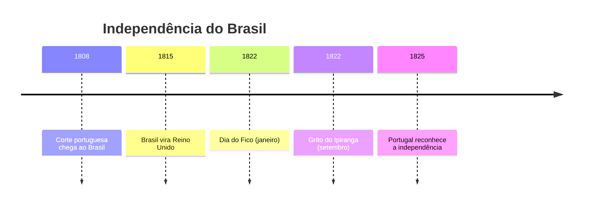

# Independência do Brasil
<!-- chapter-writer:document DOC:docs/independencia-brasileira.md -->

A independência do Brasil foi declarada em 7 de setembro de 1822 por Dom Pedro I, às margens do riacho Ipiranga, em São Paulo, com o célebre grito "Independência ou Morte!".
<!-- chapter-writer:node P-0001 -->

A transferência da corte portuguesa para o Brasil, em 1808, fugindo das tropas napoleônicas, elevou a colônia à condição de sede do Império Português e transformou o Rio de Janeiro em capital.
<!-- chapter-writer:node P-0002 -->

Em 1815, o Brasil foi elevado à condição de Reino Unido a Portugal e Algarves, deixando formalmente de ser colônia.
<!-- chapter-writer:node P-0003 -->

Com o retorno de Dom João VI a Portugal em 1821, as Cortes portuguesas tentaram reverter o Brasil à condição de colônia, provocando forte reação entre as elites locais.
<!-- chapter-writer:node P-0004 -->

Em 9 de janeiro de 1822, no Dia do Fico, Dom Pedro recusou-se a retornar a Portugal, declarando: "Se é para o bem de todos e felicidade geral da Nação, estou pronto! Digam ao povo que fico."
<!-- chapter-writer:node P-0005 -->

José Bonifácio de Andrada e Silva, o "Patriarca da Independência", articulou politicamente o processo, defendendo uma monarquia constitucional centralizada.
<!-- chapter-writer:node P-0006 -->

A princesa Leopoldina, exercendo a regência na ausência de Dom Pedro, assinou o decreto de separação em setembro de 1822, após reunião do Conselho de Estado.
<!-- chapter-writer:node P-0007 -->

A independência não foi imediata em todo o território: a Guerra da Independência (1822–1824) envolveu confrontos na Bahia, no Pará, no Maranhão e na Cisplatina.
<!-- chapter-writer:node P-0008 -->

Portugal reconheceu a independência do Brasil somente em 1825, pelo Tratado do Rio de Janeiro, mediante o pagamento de uma indenização de dois milhões de libras esterlinas.
<!-- chapter-writer:node P-0009 -->

A independência brasileira foi um processo liderado pela própria coroa e pelas elites, que preservou a monarquia e a escravidão, diferindo das revoluções populares da América espanhola.
<!-- chapter-writer:node P-0010 -->

<!-- chapter-writer:node FLOW-0001 -->

| Data | Evento |
|---|---|
| 1808 | Chegada da corte portuguesa |
| 1815 | Reino Unido de Portugal, Brasil e Algarves |
| 1822 | Dia do Fico e Grito do Ipiranga |
| 1825 | Reconhecimento por Portugal |
<!-- chapter-writer:node TABLE-0001 -->

Maria Quitéria de Jesus, que se disfarçou de soldado para lutar pela independência na Bahia, tornou-se um símbolo da participação feminina na guerra.
<!-- chapter-writer:node P-0011 -->
